# Pattern Analysis Assignment - ADNI ConvNeXt Model

## Model Details
<u>Problem Statement</u></br>
Alzheimer’s disease (AD) is a type of dementia that irreversibly impacts the memory, thinking, and behaviour of those diagnosed with it [1]. Biomarkers include hippocampal and cortical atrophy with ventricular enlargement. Automated triage systems help clinicians screen for and identify these biomarkers, reducing cognitive load and speeding up patient assessments. It is vital, however, for such systems to avoid false negative classifications, since inaccurate diagnoses may delay diagnosis and appropriate clinical intervention. This report aims to construct a ConvNeXt network to classify MRI images into their respective diagnostic categories, with particular emphasis on AD sensitivity. ConvNeXt is a modernised convolutional neural network (CNN) that incorporates design principles from Transformer architectures. It offers computational efficiency, strong performance on image-classification benchmarks, and a scalable architecture [4].

<u>The Model</u> </br>
Individual MRI slices were obtained from the Alzheimer's Disease Neuroimaging Initiative (ADNI) [3] and separated into training, validation, and test partitions. Patient-level separation was enforced between all three partitions to prevent data leakage. The ConvNeXt model processes each image through a series of convolutional stages, progressively extracting increasingly complex visual features [4] (see architecture diagrams below). Within each ConvNeXt block, a 7×7 depthwise convolution captures spatial features, while subsequent 1×1 linear layers mix information across channels. The extracted features are then passed to a classification head, which produces a probability for each diagnostic category (AD or CN).

ConvNeXt Architecture: </br>
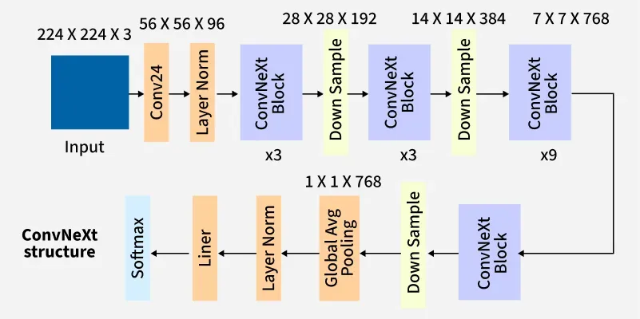

ConvNeXt Block: </br>
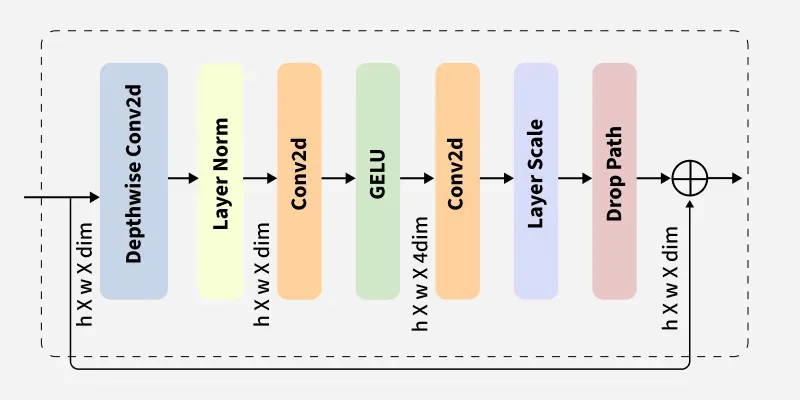

Down Sample Block: </br>
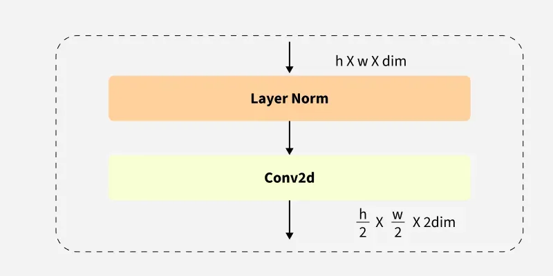

NOTE: Images come from [2]

## Feasibility Review
**1. User Need, Scope & Acceptance Criteria** </br>
This model aims to be an automated triage application for clinicians. The prototype should be able to classify patient brain MRI slices as having Alzheimer’s Disease (AD) or being Cognitively Normal (CN).
Acceptance criteria; these are tested on held-out test recordings:
-	Test accuracy ≥ 80% (project minimum) 
-	High confidence predictions (≥90%) should have an error rate ≤ 5%
-	Peak GPU VRAM usage shouldn’t go above 8GB
-	No overlap between train, test and validation datasets

**2. Model Choice & Course Concepts** </br>
Data is taken from the Alzheimer’s Disease Neuroimaging Initiative (ADNI) dataset. Images are 240x258 grayscale patient MRI scans, split into CN and AD classifications, with 20 slices per patient. The dataset partitions patients into training (556 NC, 520 AD) and test (227 NC, 223 AD) splits; details in Appendix 1. This project addresses the [Hard Difficulty] band of project 2.1 using a ConvNeXt model [4]. Baseline recordings will be taken using a standard CNN to establish an initial performance benchmark. Both models will begin with no pre-trained weights and draw upon class concepts such as convolution, loss quantification methods, and categorisation.

**3. Preliminary Feasibility Evidence** </br>
No patient overlap exists between partitions. NC and AD classes are balanced, being roughly 52% and 48% of the data, respectively. A patient-level, stratified portion (20%) of the training data was successfully taken as a validation set; details in Appendix 2. A 4-block CNN and torchivision’s ConvNext-tiny model were trained and tested on the validation set as a ‘smoke-test’.

<u>Validation Results</u>
<table>
<tr><th></th><th>CNN</th><th>ConvNeXt-tiny</th></tr>
<tr><td>Slice Acc</td><td>0.797</td><td>0.849</td></tr>
<tr><td>Slice Macro-F1</td><td>0.793</td><td>0.849</td></tr>
<tr><td>Patient Acc</td><td>0.843</td><td>0.912</td></tr>
<tr><td>Patient AUROC</td><td>0.943</td><td>0.967</td></tr>
</table>

Above validation recordings were taken from the model’s performance on its best epoch (#22). The ConvNeXt model performed better than the CNN in all categories, indicating possible applications for the given research dilemma. About 20% of validation set errors had confidence over 0.9, this should be further tested.

<u>Resource Usage</u></br>
The CNN implementation used around 2GB of VRAM with 0.39M parameters; epochs took around 7 seconds each. The ConvNeXt-tiny model used around 4GB of VRAM with 27.82M parameters; epochs took around 21 seconds each. Recordings reside within the predefined acceptance criteria.

**4. Risks, Budget & Fallback** </br>
Head shape and age variation could make it harder to extract anatomical biomarkers, leading to several ambiguous test cases. This is concerning given the high confidence on validation set errors. Confidence calibration and referral of uncertain cases for human review will be investigated.
Current model implementations reside within the 8GB VRAM requirement. The project will attempt to operate within 3 hours of A100 GPU usage time. A fallback in case of ConvNeXt failure will be further exploration of baseline and similar models.

<b>Appendix 1 – Data Overview (Before Validation Split)</b>
<table>
<tr><th>Split</th><th colspan="2">Patients</th><th colspan="2">Slices</th><th colspan="3">Slices per Patient</th></tr>
<tr><th></th><th>NC</th><th>AD</th><th>NC</th><th>AD</th><th>Min</th><th>Mean</th><th>Max</th></tr>
<tr><td>Train</td><td>556</td><td>520</td><td>11120</td><td>10400</td><td>20.0</td><td>20.0</td><td>20.0</td></tr>
<tr><td>Test</td><td>227</td><td>223</td><td>4540</td><td>4460</td><td>20.0</td><td>20.0</td><td>20.0</td></tr>
</table>

<b>Appendix 2 – Data Overview (After Validation Split)</b>
<table>
<tr><th>Split</th><th colspan="2">Patients</th><th colspan="2">Slices</th><th colspan="3">Slices per Patient</th></tr>
<tr><th></th><th>NC</th><th>AD</th><th>NC</th><th>AD</th><th>Min</th><th>Mean</th><th>Max</th></tr>
<tr><td>Train</td><td>444</td><td>416</td><td>8880</td><td>8320</td><td>20.0</td><td>20.0</td><td>20.0</td></tr>
<tr><td>Validation</td><td>112</td><td>104</td><td>2240</td><td>2080</td><td>20.0</td><td>20.0</td><td>20.0</td></tr>
<tr><td>Test</td><td>227</td><td>223</td><td>4540</td><td>4460</td><td>20.0</td><td>20.0</td><td>20.0</td></tr>
</table>

## Dependencies
Ripped from requirements.txt. Dependency list generated using the `pip freeze` command.
```
asttokens==3.0.2
black==26.10.1
click==8.5.0
cloudpickle==3.1.2
colorama==0.4.6
comm==0.2.3
contourpy==1.4.0
cycler==0.12.1
debugpy==1.8.22
executing==2.3.0
filelock==4.2.6
fonttools==4.67.0
fsspec==2026.9.0
ipykernel==7.4.0
ipython==9.17.1
ipython_pygments_lexers==1.1.1
jedi==0.20.1
Jinja2==3.1.6
joblib==1.6.0
jupyter_client==8.10.0
jupyter_core==5.9.1
kiwisolver==1.5.1
MarkupSafe==3.0.4
matplotlib==3.11.2
matplotlib-inline==0.2.2
mpmath==1.3.0
mypy_extensions==1.1.0
narwhals==2.27.1
nest-asyncio2==1.7.4
networkx==3.7
nibabel==5.4.2
numpy==2.5.4
packaging==26.3
parso==0.8.7
pathspec==1.1.1
pillow==13.0.0
platformdirs==4.13.5
prompt_toolkit==3.0.53
psutil==7.2.2
pure_eval==0.2.4
Pygments==2.21.0
pyparsing==3.3.3
python-dateutil==2.9.0.post0
pytokens==0.4.1
PyYAML==6.0.3
pyzmq==27.2.0
scikit-learn==1.9.1
scipy==1.18.1
setuptools==84.2.1
six==1.17.0
stack-data==0.6.3
sympy==1.14.0
threadpoolctl==3.7.0
torch==2.15.0
tornado==6.5.10
traitlets==5.16.1
typing_extensions==4.16.0
wcwidth==0.9.3
```

## Result Reproducability
To reproduce experiemnts, the same datasets, directory structure, dependency versions, model configurations, and random state must be used. A `random_state` variable is taken as an argument in dataset generation functions for this. However, GPU hardware and software configurations may affect numerical results, so exact reproducability across environments is not guaranteed [5]. 

## Input, Output and Plot Examples
The model accepts individual grayscale MRI slices from the ADNI dataset as input. Images are preprocess before being passed to the model (see Preprocessing). The model produces a binary classification indicating whether the image corresponds to an Alzheimer's Disease (AD) or Cognitively Normal (NC) patient. Images are 240x258 pixels in size and converted to float32 tensors before processing. </br>

Example Input Image: </br>
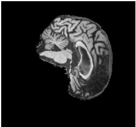

During training, the model reports training and validation loss after each epoch. This provides an indcator of how effectively the model is learning, and helps see if it is overfitting, or making little progress:

Example of the output for Epochs 1-5 of ConvNeXt training stage:
```
Epoch [1/20] | Train loss: 0.7017 | Train acc: 50.44% | Val loss: 0.6910 | Val acc: 51.85%
Epoch [2/20] | Train loss: 0.6935 | Train acc: 51.59% | Val loss: 0.6911 | Val acc: 51.85%
Epoch [3/20] | Train loss: 0.6928 | Train acc: 51.90% | Val loss: 0.6868 | Val acc: 58.54%
Epoch [4/20] | Train loss: 0.6889 | Train acc: 53.84% | Val loss: 0.6758 | Val acc: 58.80%
Epoch [5/20] | Train loss: 0.6583 | Train acc: 60.52% | Val loss: 0.5989 | Val acc: 68.43%
```

After the designated number of Epochs have finished (20 in this case), the results are compiled into a graph. </br>

Example ConvNeXt Training Output Image: </br>
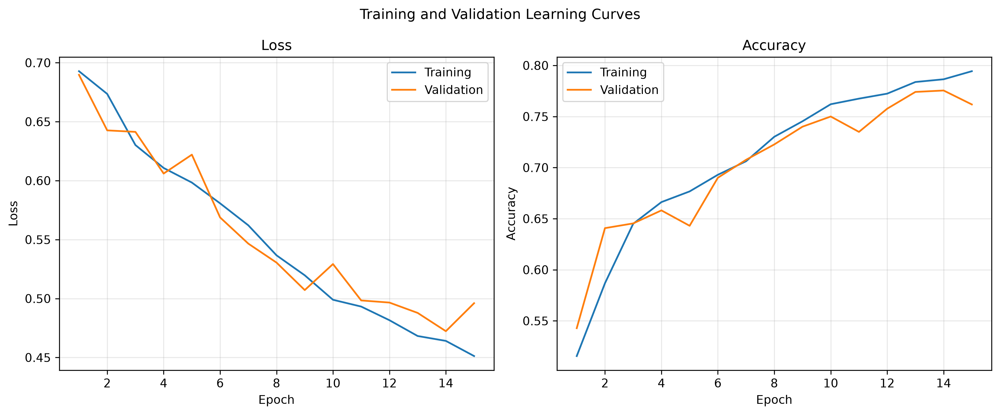

And the validation metrics and resource usage measurements are output:
```Validation metrics:
NC precision: 0.8062
AD precision: 0.7671
NC recall:    0.7746
AD recall:    0.7995
Macro-F1:     0.7865
AUROC:        0.8548
------------------------------
Resource usage details for: train_model

Training runtime: 1649.38 seconds
Peak GPU memory allocated: 1500.84 MB
Peak GPU memory reserved:  1724.00 MB
```

These outputs are returned for the training phase of both the ConvNeXt model and the CNN model.

Example testing output contains a breadth of classification, confidence, and computational metrics. Here is an excerpt of a ConvNexT output:
```
============================================================
 EVALUATION RESULTS: ConvNeXt
============================================================
Patients evaluated: 450
MRI slices evaluated: 9000

------------------------------------------------------------
CLASSIFICATION METRICS
------------------------------------------------------------
Accuracy:       0.6933
Macro-F1:       0.6918
AUROC:          0.7804
Average Prec.:  0.7768

Per-class metrics:
Class         Precision       Recall     F1-score
NC               0.6745       0.7577       0.7137
AD               0.7179       0.6278       0.6699

Confusion matrix:
                Predicted NC    Predicted AD
Actual NC                172              55
Actual AD                 83             140

------------------------------------------------------------
CONFIDENCE METRICS
------------------------------------------------------------
Confidence threshold:      90%
Coverage:                  11.56%
High-confidence accuracy: 0.9038

------------------------------------------------------------
COMPUTATIONAL METRICS
------------------------------------------------------------
Total parameters:       4,219,922
Trainable parameters:   4,219,922
Inference runtime:      17.24 s
Latency per slice:      1.92 ms
Throughput:             522.08 slices/s
Peak GPU allocated:     256.74 MB
Peak GPU reserved:      330.00 MB
```

Other images produced in this phase can be seen throughout the Open Research Dilemma Investigation part of this document.

## Preprocessing
MRI images were provided as `.jpeg` files in the designated ADNI data directory (`/home/groups/comp3710/ADNI/AD_NC`). An initial audit was performed over the dataset (refer to the Feasibility Review section), confirming no patient overlap between the original training and test partitions, and no conflicting diagnoses for individual patients. Each patient had 20 associated MRI slices, with no unusable datapoints identified (e.g. blank images or corrupted files). Images were loaded as PIL objects using Python's Pillow library and converted to grayscale, ensuring a single-channel representation. They were subsequently converted to `float32` PyTorch tensors (see the `ADNIDataset` class in `dataset.py`), with pixel values scaled to the range [0, 1]. Original image dimensions of 240 × 258 pixels were retained, with no resizing applied.

A patient-level split was performed on the original training partition, with a proportion of patients reserved for validation. This prevents data leakage, since MRI images belonging to the same patient may share similar anatomical and biomarker characteristics. Stratification was used to maintain approximately equivalent AD-to-NC patient ratios between the training and validation partitions. The original test partition was kept separate and reserved for final model evaluation. A fixed random state was supplied to ensure reproducibility.

Additional transformations were applied separately to the training and evaluation datasets. These included:
* Intensity normalisation: Normalisation of non-background pixels.
* Colour jittering: Random adjustments to image brightness and contrast (training only).
* Random affine transformations: Random geometric transformations, such as rotation and translation (training only).

## Open Research Dilemma Investigation
### Research Dilemma </br>
This investigation aims to evaluate whether increased architectural complexity provides meaningful improvmenet in the classification of Alzheimer's disease against ADNI MRI images. Model complexity is often thought to correspond to representational capacity, and consequently, improved classification performance. ConvNeXt and CNN models will be trained and tested on the aforementioned ADNI dataset to attempt to ascertain whether the complexity to accuracy debate has any merit. Both models produced slice-level predictions, with each MRI slice treated as an individual classification sample. All reported evaluation metrics were calculated at the slice level; patient-level aggregation was not performed. 

The CNN consists of three convolutional blocks followed by a global average pooling and subsequent classification layers. ConvNeXt uses the aforementioned ConvNeXt blocks to progressively increment channel dimensions. Both models were trained from scratch using cross-entropy loss.
</br>

### A Brief Look at ConvNeXt Parameter Evolution </br>
Model parameters were found through iterative experimentation; the progression of which is summarised below. Before using the `RandomAffine` and `ColorJitter` image transforms, the ConvNeXt model heavily overfit the training data, often reaching training accuracies around 78% with validation accuracies around 40%. Implementing these made the accuracies align. ConvNeXt models with 3 and 4 sequential ‘ConvNeXt blocks’ had no meaningful difference. The same holds for decreasing ConvNeXt block depths from (3, 3, 9, 3) to (2, 2, 4, 2) and channel dimensions from (96, 192, 384, 768) to (48, 96, 192, 384). Consequently, the ‘larger’ configurations were used to provide greater model capacity. Increasing weight decay from 0.1 to 0.3 did not affect results but significantly increased training time. Training was limited to 15 epochs, as experiments indicated that additional epochs generally provided negligible improvements or degraded validation performance. The final configuration was selected based on validation performance and training efficiency. The following parameters were used (excerpt from config/convnext.yaml):
```yaml
# Model settings
drop-path-rate: 0.5
layer-scale-init-val: 0.000001
depths: [3, 3, 9, 3]
dims: [96, 192, 384, 768]

learning-rate: 0.0001
weight-decay: 0.1
confidence-threshold: 0.9

# Image transform configuration
random-affine:
  degrees: 5
  translate: [0.03, 0.03]
  scale: [0.97, 1.03] 
  fill: 0

colour-jitter:
  brightness: 0.1
  contrast: 0.1
```

### Quantitative Benchmarking </br>
The primary research question investigated was how a custom ConvNeXt architecture compes to a baseline CNN model in the classification of ADNI MRI scans. Both models were trained on the same training and validation splits, then evaluated against the provided test set. 

### Validation Performance </br>
20% of the supplied training data was used as a hold-out validation set. ConvNeXt performed better in all reported metrics, suggesting that a more complex architecture helps distinguish between classifications. ConvNeXt's final epochs achieved the highest validation accuracy (80.76%), while the CNN hit a maximum of (77.55%). Metrics are seen in the table below:

<table>
    <thead>
        <tr><th>Validation metric</th><th>ConvNeXt</th><th>CNN</th></tr>
    </thead>
    <tbody>
        <tr><td>Accuracy</td><td><strong>80.76%</strong></td><td>77.55%</td></tr>
        <tr><td>Macro-F1</td><td><strong>0.8076</strong></td><td>0.7755</td></tr>
        <tr><td>AUROC</td><td><strong>0.8706</strong></td><td>0.8608</td></tr>
        <tr><td>NC precision</td><td><strong>0.8455</strong></td><td>0.8095</td></tr>
        <tr><td>AD precision</td><td><strong>0.7738</strong></td><td>0.7447</td></tr>
        <tr><td>NC recall</td><td><strong>0.7696</strong></td><td>0.7415</td></tr>
        <tr><td>AD recall</td><td><strong>0.8486</strong></td><td>0.8120</td></tr>
    </tbody>
</table>

### Test Performance </br>
However, the validation results didn't translate into test performance.

<table>
    <thead>
        <tr><th>Test metric</th><th>ConvNeXt</th><th>CNN</th></tr>
    </thead>
    <tbody>
        <tr><td>Accuracy</td><td>68.59%</td><td><strong>72.12%</strong></td></tr>
        <tr><td>Macro-F1</td><td>0.6856</td><td><strong>0.7205</strong></td></tr>
        <tr><td>AUROC</td><td>0.7535</td><td><strong>0.7982</strong></td></tr>
        <tr><td>Average precision</td><td>0.7361</td><td><strong>0.8015</strong></td></tr>
        <tr><td>NC precision</td><td>0.6812</td><td><strong>0.7069</strong></td></tr>
        <tr><td>AD precision</td><td>0.6911</td><td><strong>0.7385</strong></td></tr>
        <tr><td>NC recall</td><td>0.7093</td><td><strong>0.7643</strong></td></tr>
        <tr><td>AD recall</td><td>0.6621</td><td><strong>0.6774</strong></td></tr>
    </tbody>
</table>

Despite a 3.1 percentage-point increase in validation accuracy, the ConvNeXt architecture scored 4 percentage-points below the CNN in test samples; failing to meet the aforementioned 80% cut-off. The CNN also scored higher in all calculated metrics.

### Confusion Matrix Analysis </br>

The constructed confusion matrices provide insight into exactly where errors occured for each slice classification.

CNN Confusion Matrix: </br>
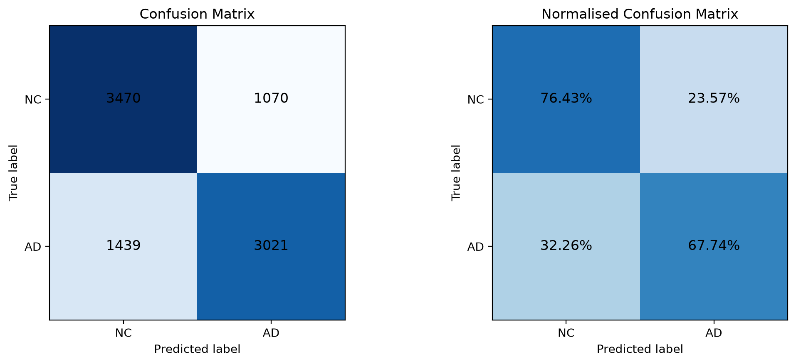

ConvNeXt Confusion Matrix: </br>


Both models had similar success in AD classifications. However, the CNN had a 6% improvement over the ConvNeXt network for NC predictions. Due to the intended clinical applications of these models, it was hoped to minimise the false negatives rates of all models. Unfortunately, the CNN had a rate of 32.26%, while the ConvNeXt had a rate of 33.79%. This poses a significant limitation for clinical applications and will be further assessed.

### Confidence Analysis

Both models were evaluated using a 90% confidence threshold. In other words, if the the softmax probability for a classification was over 0.9, the prediction was considered 'high-confidence'.

<table>
    <thead>
        <tr><th>Confidence metric</th><th>ConvNeXt</th><th>CNN</th></tr>
    </thead>
    <tbody>
        <tr><td>Confidence threshold</td><td>90%</td><td>90%</td></tr>
        <tr><td>Coverage</td><td>21.02%</td><td>19.39%</td></tr>
        <tr><td>Accuracy on accepted predictions</td><td>83.19%</td><td><strong>90.14%</strong></td></tr>
    </tbody>
</table>

Only around one fifth of the predictions made by either model were considered 'high-confidence'. However, when this was the case the ConvNeXt and CNN models were correct 83.19% and 90.14% of the time, respectively. This violates the feasibility review's criterion that 'high-confidence' predictions must have an error rate below 5%. Confidence should therefore be interpreted cautiously, and probability calibration would be a useful area for further investigation. Furthermore, it reveals that both models considered the majority of the data set to be 'amiguous' in classification.

The below graphs demonstrate how coverage (the percent of the highest confidence recordings accepted), relates to classification accuracy. For example if we were to take the top 20% of the CNN models most confident predictions, we would have an accuracy of about 90%. This is the 90% threshold in the graph above.

CNN Confidence-Coverage Graph: </br>
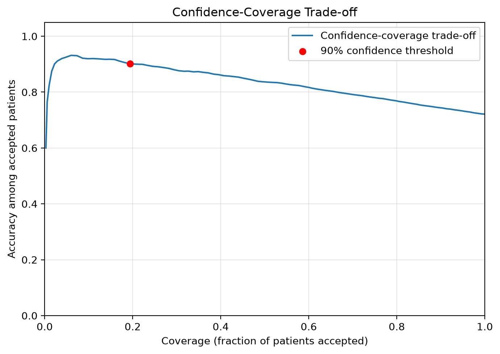

ConvNeXt Confidence-Coverage Graph: </br>
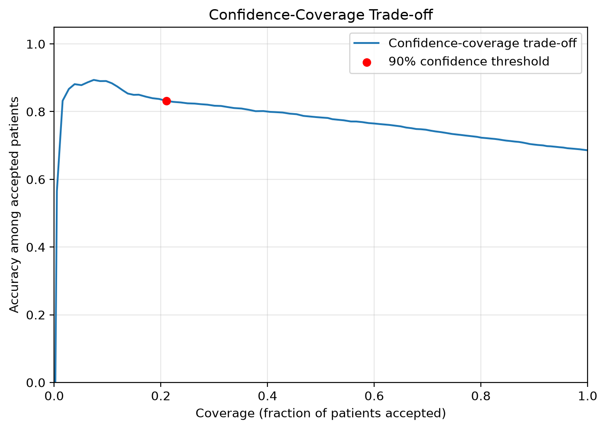

### Computational Resource Profiling

Computational efficiency was evaluated using parameter count, GPU memory consumption, training runtime and inference performance. Both models were evaluated using the same test dataset and inference batch size of 32.

<table>
    <thead>
        <tr><th>Resource metric</th><th>ConvNeXt</th><th>CNN</th></tr>
    </thead>
    <tbody>
        <tr><td>Total parameters</td><td>27,818,594</td><td>92,930</td></tr>
        <tr><td>Trainable parameters</td><td>27,818,594</td><td>92,930</td></tr>
        <tr><td>Training runtime</td><td>1,885.22 s</td><td>928.79 s</td></tr>
        <tr><td>Peak training GPU memory allocated</td><td>4,840.33 MB</td><td>840.52 MB</td></tr>
        <tr><td>Inference runtime</td><td>22.13 s</td><td>12.99 s</td></tr>
        <tr><td>Inference latency per slice</td><td>2.46 ms</td><td>1.44 ms</td></tr>
        <tr><td>Inference throughput</td><td>406.75 slices/s</td><td>692.87 slices/s</td></tr>
        <tr><td>Peak inference GPU memory allocated</td><td>574.63 MB</td><td>435.98 MB</td></tr>
    </tbody>
</table>

The ConvNeXt architecture contains approximately 299 times as many parameters as the CNN, and took about twice as long to train. It also had an inference latency around 71% higher. Despite this, the ConvNeXt model performed worse on the held-out test set; meaning the CNN provides a more favourable balance between classification performance and computational efficiency.

Both architectures remained within the feasibility report's 8 GB GPU memory acceptance criterion during training. PyTorch's peak reserved GPU memory was also recorded separately: 5,138 MB for ConvNeXt and 6,042 MB for the CNN. Reserved memory represents memory held by PyTorch's caching allocator rather than memory actively allocated to tensors, so allocated memory is used for the primary comparison.

## Qualitative Error Autopsies
A notable observation across both architectures was the concentration of highly confident errors within individual patients. For ConvNeXt, all five of the most confidently incorrect false-negative examples belonged to patient 985197. Slices will be extracted from three such patients 1214021, 985197, and 1175051, then analysed to see if any defining traits may have caused these errors.

<u>CASE 1: ConvNeXt false positive</u></br>
- *Patient ID:* 1214021
- *Image:* `1214021_96.jpeg`
- *Actual class:* NC
- *Predicted class:* AD
- *AD probability:* 91.98%

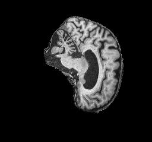

Alzheimer's disease is associae with brain atrophy (loss of tissue), which can cause brain sulci to appear wider than normal [6]. Darker regions seem to appear frequently in the above region, particularly around the cortical sulci. These spaces are visually noticeable between the surroinding cortical folds. It's possible these regions caused the ConvNeXt network to interprete the darker regions as Alzheimer's induced atrophy, thus causing an incorrect AD classification. The high AD probability (91.98%) indicates the model may have overly erelied on this feature to make predictions.

<u>CASE 2: ConvNeXt false negative</u></br>
- *Patient ID:* 985197
- *Image:* `985197_94.jpeg`
- *Actual class:* AD
- *Predicted class:* NC
- *AD probability:* 0.08% 

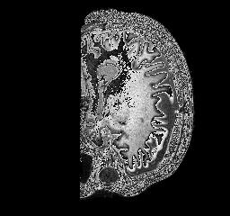

Unlike the rest of the dataset, this MRI image appears to be incredibly granular. The left side of the MRI also appears to be cut off, it is unclear if this is due to a cropping of the actual MRI image, poor imaging techniques, or it is just an outlier in terms of evidence. A clear disprepency in visual acuity can be seen between this case, and cases 1 and 3. As such, it is likely that the model isn't prepared for this kind of 'outlier' image, and others like it that may exists in the dataset, resulting in an incorrect classification.

<u>CASE 3: CNN false negative</u></br>
- *Patient ID** 1175051
- *Image:* `1175051_90.jpeg`
- *Actual class:* AD
- *Predicted class:* NC
- *AD probability:* 0.05%

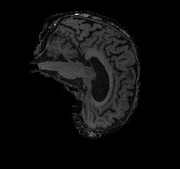

Compared with Case 1, the prominent dark spaces around cortical sulci appear less pronounced, possibly causing the NC classification. The small 0.05% AD probability also corroborates the idea of an overreliance on cortical sulci spacing in the models predictions. Additionally, the image appears to be shaded darker than previous slices, possibly influencing the models classification abilities.

<u>Note</u></br>
It is important to note that this model comes with the limitation of using slice-level evaluation, since a large number of misclassified slices may originate from a minority of the patients taken. Patient level slice aggregation should be considered in the future, or some methodology capable of it, in an attempt to rectify this issue.

## Engineering Recommendations and Trade-off Synthesis
The experiments demonstrate that the more complex ConvNeXt architecture didn't provide apractical advatnage over the simpler CNN. Although the ConvNeXt architecture had stronger training and validation resulsts, it had lower accuracy, macro-F1, AUROC, and precision in the test set. The CNN also required substantially fewer parameters, less training time and lower inference resources.

Previous research has demonstrated strong performance using ConvNeXt architectures for Alzheimer's disease MRI classification, with some studies reporting accuracy approaching 90% [7]. However, these results were obtained using different datasets and experimental configurations, making direct comparisons inappropriate. Nevertheless, they demonstrate the potential of ConvNeXt architectures and motivate further investigation into their application to ADNI data.

Based on this reports findings, and previous research, the following engineering recommendations are proposed:
1. **Retain the CNN as the baseline and current preferred model** - it showed stronger test performance and substantially lower computational requirements; it can be used as stand in while ConvNeXt improvements are investigated
2. **Investigate the validation-to-test performance discrepancy** - further examination of class distributions, patient characteristics, slice-index distributions and image intensity characteristics may reveal the reasoning behind these result discrepencies
3. **Investigate patient-specific classification errors** - misscategorisations often occured across slices shared by patients, these patients shuold be investigated to see what biomarkers make their MRI slices 'ambiguous' in the eyes of the model
4. **Investigate pretrained initialisation** - experimenting with pretrained models may prove beneficial in feature extraction, and has been successfully implemented in the past [7]
5. **Improve confidence reliability** - calibration methods and validation-based confidence thresholds should be investigated before using confidence scores to determine whether predictions should be accepted or referred for further review.

**Final recommendation:** Based on the current experimental evidence, the CNN is the preferred clinical application. However, neither architecture is capable of being a standalone diagnostic system; further investigation is required before clinical application. Future improvements should prioritise reliable AD detection, and trustworthy confidence estimates rather than simply increasing model complexity. It is likely this implementation of the ConvNeXt model is flawed, as similar projects have achieved much higher acceptance rates.


## AI Intelligence Usage Disclosure
<u>**Entry 1**</u></br>
**Model:** ChatGPT </br>
**Task:** Asked it to generate the `def print_split_stats(stats: dict)` function in `audit.py` </br>
**Notes:**</br>
Helped make a function to print `split_stats` object to terminal. Verified by checking to make sure print statements were related to correct object parameters. Why use it? Figured it would make something look neat quickly. Tested by just running the `audit.py` file and checking the terminal output. Showed what I needed therefore W's. 

<u>**Entry 2**</u></br>
**Model:** ChatGPT </br>
**Task:** Asked it to convert my Validation Results table from word into a markdown-compatible format (table in feasability report section).</br>
**Notes:**</br>
I gave it an unfinished table (I had written the first two rows myself), then got bored and asked GPT to format the rest for me. Validation was easy since 1. I just need to visually check the ouptut to ensure correctness, and 2. it's just finishing off the work I'd already done. 

<u>**Entry 3**</u></br>
**Model:** ChatGPT </br>
**Task:** Exact same as entry 2 except with the appendix tables for feasability review.</br>
**Notes:**</br>
See enty 2. Although I just threw the data at it this time. I didn't start the tables at all. Verfieid output visually. 

<u>**Entry 4**</u></br>
**Model:** ChatGPT </br>
**Task:** Asked it to generate the `print_evaluation_results` function in `predict.py`.</br>
**Notes:**</br>
Basic printing function that takes a result dict and prints it (neatly-ish) to the terminal. Verified by looking at the output / checking that the parameters were printed in the right order / way.

## References
* [1] Alzheimer's Association, “What Is Alzheimer's Disease?” Available: https://www.alz.org/alzheimers-dementia/what-is-alzheimers.
* [2] GeeksforGeeks, “ConvNeXt,” 2025. Available: https://www.geeksforgeeks.org/computer-vision/convnext/.
* [3] Alzheimer's Disease Neuroimaging Initiative (ADNI), “ADNI Documentation.” Available: https://adni.loni.usc.edu/help-faqs/adni-documentation/.
* [4] Z. Liu, H. Mao, C.-Y. Wu, C. Feichtenhofer, T. Darrell, and S. Xie, “A ConvNet for the 2020s,” in Proc. CVPR, 2022, pp. 11976–11986.
* [5] O. E. Gundersen, S. Shamsaliei, and R. J. Isdahl, “Do machine learning platforms provide out-of-the-box reproducibility?,” Future Generation Computer Systems, vol. 126, pp. 34–47, Jan. 2022. https://doi.org/10.1016/j.future.2021.06.014.
* [6] A. Chaddad, C. Desrosiers, and T. Niazi, “Deep radiomic analysis of MRI related to Alzheimer’s disease,” IEEE Access, vol. 6, pp. 58213–58221, 2018. https://doi.org/10.1109/ACCESS.2018.2871977
* [7] M. Basereh, M. A. Abikenari, S. Sadeghzadeh, T. Dunn, R. Freichel, P. Siddarth, D. Ghahremani, H. Lavretsky, and V. P. Buch, “ConvNeXt-driven detection of Alzheimer’s disease: A benchmark study on expert-annotated AlzaSet MRI dataset across anatomical planes,” Diagnostics, vol. 15, no. 23, Art. no. 2997, Nov. 2025. https://doi.org/10.3390/diagnostics15232997
