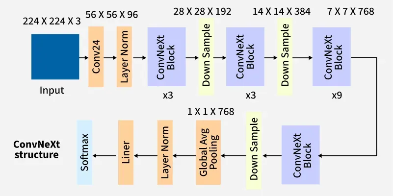
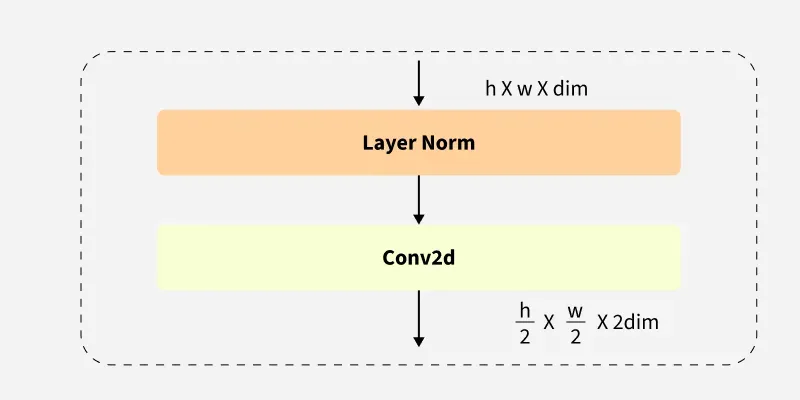
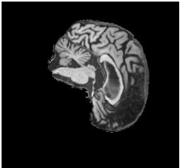

# Pattern Analysis Assignment - ADNI ConvNeXt Model

## Model Details
<u>Problem Statement</u></br>
Alzheimer’s disease (AD) is a type of dementia that irreversibly impacts the memory, thinking, and behaviour of those diagnosed with it [1]. Biomarkers include hippocampal and cortical atrophy with ventricular enlargement. Automated triage systems help clinicians screen for and identify these biomarkers, reducing cognitive load and speeding up patient assessments. It is vital, however, for such systems to avoid false negative classifications, since inaccurate diagnoses may delay diagnosis and appropriate clinical intervention. This report aims to construct a ConvNeXt network to classify MRI images into their respective diagnostic categories, with particular emphasis on AD sensitivity. ConvNeXt is a modernised convolutional neural network (CNN) that incorporates design principles from Transformer architectures. It offers computational efficiency, strong performance on image-classification benchmarks, and a scalable architecture [4].

<u>The Model</u> </br>
Individual MRI slices were obtained from the Alzheimer's Disease Neuroimaging Initiative (ADNI) [3] and separated into training, validation, and test partitions. Patient-level separation was enforced between all three partitions to prevent data leakage. The ConvNeXt model processes each image through a series of convolutional stages, progressively extracting increasingly complex visual features [4] (see architecture diagrams below). Within each ConvNeXt block, a 7×7 depthwise convolution captures spatial features, while subsequent 1×1 linear layers mix information across channels. The extracted features are then passed to a classification head, which produces a probability for each diagnostic category (AD or CN).

ConvNeXt Architecture: </br>


ConvNeXt Block: </br>


Down Sample Block: </br>


<u>References</u></br>
* [1] Alzheimer's Association, “What Is Alzheimer's Disease?” Available: https://www.alz.org/alzheimers-dementia/what-is-alzheimers.
* [2] GeeksforGeeks, “ConvNeXt,” 2025. Available: https://www.geeksforgeeks.org/computer-vision/convnext/.
* [3] Alzheimer's Disease Neuroimaging Initiative (ADNI), “ADNI Documentation.” Available: https://adni.loni.usc.edu/help-faqs/adni-documentation/.
* [4] Z. Liu, H. Mao, C.-Y. Wu, C. Feichtenhofer, T. Darrell, and S. Xie, “A ConvNet for the 2020s,” in Proc. CVPR, 2022, pp. 11976–11986.

NOTE: Images come from [2]

## Feasibility Review
**1. User Need, Scope & Acceptance Criteria** </br>
This model aims to be an automated triage application for clinicians. The prototype should be able to classify patient brain MRI slices as having Alzheimer’s Disease (AD) or being Cognitively Normal (CN).
Acceptance criteria; these are tested on held-out test recordings:
-	Test accuracy ≥ 80% (project minimum) 
-	High confidence predictions (≥90%) should have an error rate ≤ 5%
-	Peak GPU VRAM usage shouldn’t go above 8GB
-	No overlap between train, test and validation datasets

**2. Model Choice & Course Concepts** </br>
Data is taken from the Alzheimer’s Disease Neuroimaging Initiative (ADNI) dataset. Images are 240x258 grayscale patient MRI scans, split into CN and AD classifications, with 20 slices per patient. The dataset partitions patients into training (556 NC, 520 AD) and test (227 NC, 223 AD) splits; details in Appendix 1. This project addresses the [Hard Difficulty] band of project 2.1 using a ConvNeXt model [1]. Baseline recordings will be taken using a standard CNN to establish an initial performance benchmark. Both models will begin with no pre-trained weights and draw upon class concepts such as convolution, loss quantification methods, and categorisation.

**3. Preliminary Feasibility Evidence** </br>
No patient overlap exists between partitions. NC and AD classes are balanced, being roughly 52% and 48% of the data, respectively. A patient-level, stratified portion (20%) of the training data was successfully taken as a validation set; details in Appendix 2. A 4-block CNN and torchivision’s ConvNext-tiny model were trained and tested on the validation set as a ‘smoke-test’.

<u>Validation Results</u>
<table>
<tr><th></th><th>CNN</th><th>ConvNeXt-tiny</th></tr>
<tr><td>Slice Acc</td><td>0.797</td><td>0.849</td></tr>
<tr><td>Slice Macro-F1</td><td>0.793</td><td>0.849</td></tr>
<tr><td>Patient Acc</td><td>0.843</td><td>0.912</td></tr>
<tr><td>Patient AUROC</td><td>0.943</td><td>0.967</td></tr>
</table>

Above validation recordings were taken from the model’s performance on its best epoch (#22). The ConvNeXt model performed better than the CNN in all categories, indicating possible applications for the given research dilemma. About 20% of validation set errors had confidence over 0.9, this should be further tested.

<u>Resource Usage</u></br>
The CNN implementation used around 2GB of VRAM with 0.39M parameters; epochs took around 7 seconds each. The ConvNeXt-tiny model used around 4GB of VRAM with 27.82M parameters; epochs took around 21 seconds each. Recordings reside within the predefined acceptance criteria.

**4. Risks, Budget & Fallback** </br>
Head shape and age variation could make it harder to extract anatomical biomarkers, leading to several ambiguous test cases. This is concerning given the high confidence on validation set errors. Confidence calibration and referral of uncertain cases for human review will be investigated.
Current model implementations reside within the 8GB VRAM requirement. The project will attempt to operate within 3 hours of A100 GPU usage time. A fallback in case of ConvNeXt failure will be further exploration of baseline and similar models.

**References** </br>
[1]	Z. Liu, H. Mao, C.-Y. Wu, C. Feichtenhofer, T. Darrell, and S. Xie, “A ConvNet for the 2020s,” in Proc. CVPR, 2022, pp. 11976–11986.

<b>Appendix 1 – Data Overview (Before Validation Split)</b>
<table>
<tr><th>Split</th><th colspan="2">Patients</th><th colspan="2">Slices</th><th colspan="3">Slices per Patient</th></tr>
<tr><th></th><th>NC</th><th>AD</th><th>NC</th><th>AD</th><th>Min</th><th>Mean</th><th>Max</th></tr>
<tr><td>Train</td><td>556</td><td>520</td><td>11120</td><td>10400</td><td>20.0</td><td>20.0</td><td>20.0</td></tr>
<tr><td>Test</td><td>227</td><td>223</td><td>4540</td><td>4460</td><td>20.0</td><td>20.0</td><td>20.0</td></tr>
</table>

<b>Appendix 2 – Data Overview (After Validation Split)</b>
<table>
<tr><th>Split</th><th colspan="2">Patients</th><th colspan="2">Slices</th><th colspan="3">Slices per Patient</th></tr>
<tr><th></th><th>NC</th><th>AD</th><th>NC</th><th>AD</th><th>Min</th><th>Mean</th><th>Max</th></tr>
<tr><td>Train</td><td>444</td><td>416</td><td>8880</td><td>8320</td><td>20.0</td><td>20.0</td><td>20.0</td></tr>
<tr><td>Validation</td><td>112</td><td>104</td><td>2240</td><td>2080</td><td>20.0</td><td>20.0</td><td>20.0</td></tr>
<tr><td>Test</td><td>227</td><td>223</td><td>4540</td><td>4460</td><td>20.0</td><td>20.0</td><td>20.0</td></tr>
</table>

## Dependencies
Ripped from requirements.txt. Dependency list generated using the `pip freeze` command.
```
NOTE TO SELF: REFILL THIS (pretty please)
```

## Result Reproducability
To reproduce experiemnts, the same datasets, directory structure, dependency versions, model configurations, and random state must be used. A `random_state` variable is taken as an argument in dataset generation functions for this. However, GPU hardware and software configurations may affect numerical results, so exact reproducability across environments is not guaranteed [1]. 

* [1] O. E. Gundersen, S. Shamsaliei, and R. J. Isdahl, “Do machine learning platforms provide out-of-the-box reproducibility?,” Future Generation Computer Systems, vol. 126, pp. 34–47, Jan. 2022. https://doi.org/10.1016/j.future.2021.06.014.

## Input, Output and Plot Examples
The model accepts individual grayscale MRI slices from the ADNI dataset as input. Images are preprocess before being passed to the model (see Preprocessing). The model produces a binary classification indicating whether the image corresponds to an Alzheimer's Disease (AD) or Cognitively Normal (NC) patient. Images are 240x258 pixels in size and converted to float32 tensors before processing. </br>

Example Input Image: </br>


During training, the model reports training and validation loss after each epoch. This provides an indcator of how effectively the model is learning, and helps see if it is overfitting, or making little progress:

Example of the output for Epochs 1-5 of ConvNeXt training stage:
```
Epoch [1/20] | Train loss: 0.7017 | Train acc: 50.44% | Val loss: 0.6910 | Val acc: 51.85%
Epoch [2/20] | Train loss: 0.6935 | Train acc: 51.59% | Val loss: 0.6911 | Val acc: 51.85%
Epoch [3/20] | Train loss: 0.6928 | Train acc: 51.90% | Val loss: 0.6868 | Val acc: 58.54%
Epoch [4/20] | Train loss: 0.6889 | Train acc: 53.84% | Val loss: 0.6758 | Val acc: 58.80%
Epoch [5/20] | Train loss: 0.6583 | Train acc: 60.52% | Val loss: 0.5989 | Val acc: 68.43%
```

After the designated number of Epochs have finished (20 in this case), the results are compiled into a graph. </br>

Example ConvNeXt Training Output Image: </br>


And the validation metrics and resource usage measurements are output:
```Validation metrics:
NC precision: 0.8062
AD precision: 0.7671
NC recall:    0.7746
AD recall:    0.7995
Macro-F1:     0.7865
AUROC:        0.8548
------------------------------
Resource usage details for: train_model

Training runtime: 1649.38 seconds
Peak GPU memory allocated: 1500.84 MB
Peak GPU memory reserved:  1724.00 MB
```


Together, these examples demonstrate the complete inference pipeline, from an individual MRI slice to a predicted diagnostic class, while the evaluation plots provide quantitative and qualitative evidence of model performance.

## Preprocessing
MRI images were provided as `.jpeg` files in the designated ADNI data directory (`/home/groups/comp3710/ADNI/AD_NC`). An initial audit was performed over the dataset (refer to the Feasibility Review section), confirming no patient overlap between the original training and test partitions, and no conflicting diagnoses for individual patients. Each patient had 20 associated MRI slices, with no unusable datapoints identified (e.g. blank images or corrupted files). Images were loaded as PIL objects using Python's Pillow library and converted to grayscale, ensuring a single-channel representation. They were subsequently converted to `float32` PyTorch tensors (see the `ADNIDataset` class in `dataset.py`), with pixel values scaled to the range [0, 1]. Original image dimensions of 240 × 258 pixels were retained, with no resizing applied.

A patient-level split was performed on the original training partition, with a proportion of patients reserved for validation. This prevents data leakage, since MRI images belonging to the same patient may share similar anatomical and biomarker characteristics. Stratification was used to maintain approximately equivalent AD-to-NC patient ratios between the training and validation partitions. The original test partition was kept separate and reserved for final model evaluation. A fixed random state was supplied to ensure reproducibility.

Additional transformations were applied separately to the training and evaluation datasets. These included:
* Intensity normalisation: Normalisation of non-background pixels.
* Colour jittering: Random adjustments to image brightness and contrast (training only).
* Random affine transformations: Random geometric transformations, such as rotation and translation (training only).

## Open Research Dilemma Investigation

## AI Intelligence Usage Disclosure
<u>**Entry 1**</u></br>
**Model:** ChatGPT </br>
**Task:** Asked it to generate the `def print_split_stats(stats: dict)` function in `audit.py` </br>
**Notes:**</br>
Helped make a function to print `split_stats` object to terminal. Verified by checking to make sure print statements were related to correct object parameters. Why use it? Figured it would make something look neat quickly. Tested by just running the `audit.py` file and checking the terminal output. Showed what I needed therefore W's. 

<u>**Entry 2**</u></br>
**Model:** ChatGPT </br>
**Task:** Asked it to convert my Validation Results table from word into a markdown-compatible format (table in feasability report section).</br>
**Notes:**</br>
I gave it an unfinished table (I had written the first two rows myself), then got bored and asked GPT to format the rest for me. Validation was easy since 1. I just need to visually check the ouptut to ensure correctness, and 2. it's just finishing off the work I'd already done. 

<u>**Entry 3**</u></br>
**Model:** ChatGPT </br>
**Task:** Exact same as entry 2 except with the appendix tables for feasability review.</br>
**Notes:**</br>
See enty 2. Although I just threw the data at it this time. I didn't start the tables at all. Verfieid output visually. 